# ParalleL-System

**ParalleL-System** is a C++ project for generating and rendering **L-systems**, with a sequential CPU implementation and a parallel implementation built using [Kokkos](https://kokkos.org/).

The project explores how both string rewriting and turtle-based rendering can be parallelized to generate fractal structures.

## What is an L-system?

An **L-system** (Lindenmayer system) is a formal rewriting system. It starts with an initial string, called the **axiom**, and repeatedly applies production rules to generate increasingly complex strings. L-systems are commonly used to model plants, branching structures, and fractals.

For example, consider:

- **Alphabet:** `V = {A, B}`
- **Axiom:** `A`
- **Production rules:** `A → AB` and `B → A`

At each iteration, every `A` is replaced with `AB`, and every `B` is replaced with `A`:

| Iteration | Result |
| --- | --- |
| `n = 0` | `A` |
| `n = 1` | `AB` |
| `n = 2` | `ABA` |
| `n = 3` | `ABAAB` |

The generated symbols can also represent drawing commands. In turtle graphics, for example:

- `F` means move forward while drawing a line.
- `+` and `-` mean rotate by a specified angle in opposite directions.

Using the axiom `F` and the production rule `F → F+F-F-F+F`, we can generate a Koch-type fractal. The following illustration shows the result after four iterations:



## Parallelizing L-systems

A straightforward implementation of an L-system rewrites its string sequentially, while a conventional turtle interpreter processes drawing commands in order. However, both stages offer opportunities for parallel execution.

### Parallel string rewriting

The rewritten length contributed by each symbol can be computed independently. By calculating output offsets, parallel threads can write their corresponding replacements into separate regions of the resulting string.

### Parallel turtle interpretation

Turtle movements can be represented using **4 × 4 transformation matrices**. Because matrix multiplication is associative, transformations can be combined using parallel algorithms while preserving their order.

This approach is related to the techniques described in [Parallel Generation of L-Systems](https://www.cg.tuwien.ac.at/research/publications/2009/LIPP-2009-PGL/LIPP-2009-PGL-paper.pdf).

## Requirements

- A C++ compiler, such as `g++`
- [CMake](https://cmake.org/)
- For the parallel implementation: [Kokkos](https://kokkos.org/) and a supported execution backend
- For CUDA builds: the NVIDIA CUDA toolkit, including [`nvcc`](https://docs.nvidia.com/cuda/cuda-compiler-driver-nvcc/index.html)
- For HIP builds: the AMD [ROCm toolchain](https://rocm.docs.amd.com/)

## Build instructions

Clone the repository:

```bash
git clone https://github.com/Pierre-Bartoli/ParalleL-System.git
cd ParalleL-System
```

### Sequential CPU implementation

```bash
cd CPU
cmake -S . -B build
cmake --build build
```

The executable is located at `CPU/build/L-system_CPU` (relative to the repository root).

### Parallel implementation (Kokkos)

Enter the GPU project directory:

```bash
cd GPU
```

Configure CMake for your chosen Kokkos backend and target architecture. For example, for CUDA on an NVIDIA RTX 5070:

```bash
cmake -S . -B build \
  -DKokkos_ENABLE_CUDA=ON \
  -DCMAKE_CUDA_ARCHITECTURES=120
cmake --build build
```

The executable is located at `GPU/build/L-system_GPU` (relative to the repository root).

Backend and architecture settings depend on your hardware and Kokkos configuration. See the Kokkos documentation for [build configuration](https://kokkos.org/kokkos-core-wiki/get-started/building-from-source.html#configuring-kokkos) and [supported architectures](https://kokkos.org/kokkos-core-wiki/get-started/configuration-guide.html#architectures).

## Usage

The program takes an input file describing the L-system and produces an SVG image.

### Input file format

The input file must contain the following, **in order**:

1. The rotation angle, in degrees.
2. The number of rewriting iterations (`n`).
3. The axiom (initial string).
4. One production rule per line, written as `predecessor=successor`.

For example, `F=AB` replaces each `F` with `AB`. The `=` separator is required.

### Run the program

From the `GPU` directory, run:

```bash
./build/L-system_GPU -i ../example.txt -o Lsystem.svg
```

The program reads the L-system definition from `example.txt` and writes the rendered result to `Lsystem.svg`.

On Windows, adjust the executable path and separators for your shell and build configuration.

## References

- [Parallel Generation of L-Systems (2009)](https://www.cg.tuwien.ac.at/research/publications/2009/LIPP-2009-PGL/LIPP-2009-PGL-paper.pdf)
- [Kokkos documentation](https://kokkos.org/kokkos-core-wiki/)
